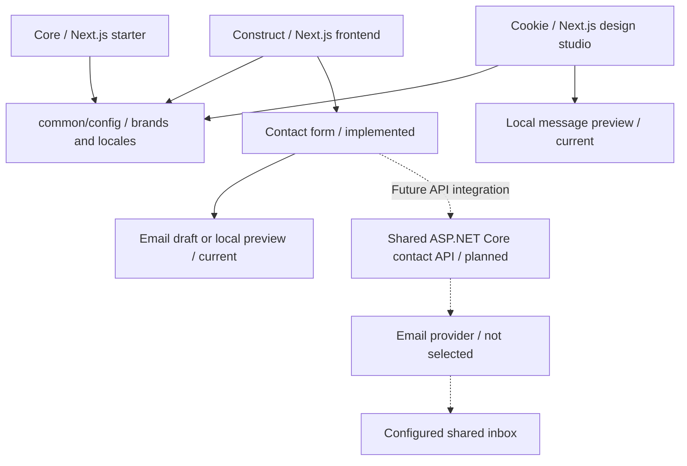

# Architecture and integration boundaries

## Implemented

One monorepo contains independent Next.js applications and shared configuration. Construct has a multilingual web studio frontend; Cookie has a multilingual design studio concept; Core remains an unstyled starter. Other brand applications have not been created.

The page and scene markup are server-rendered. Small client components enhance scrolling, the elastic footer and the contact forms. Each brand owns its design tokens and local components. Native scrolling, reduced-motion support and cleanup of animation/input handlers are part of the current implementation. Cookie's design boards and colour-to-interface transition have static alternatives for mobile, short viewports and enlarged text.

Solid edges show current behavior; dashed edges show planned delivery. A prepared email draft is not a server submission or delivery confirmation.

## Next operational slice

A small ASP.NET Core API should receive and validate the originating brand, locale, visitor details, optional business, message and source path. Email credentials and recipient routing stay server-side. Configure a verified sender and set the visitor's address as Reply-To.

The proposed `/api/contact` contract is not implemented. Choose the provider, delivery acceptance semantics, request limits, basic spam protection and production hosting before connecting the frontend. Prefer one configured shared inbox initially. Decide whether the browser reaches the API through a same-origin route/rewrite or an explicitly allowed origin.

Do not report success when provider handoff fails. A provider accepting a message does not prove inbox arrival. Define the client-facing response accordingly.

## Deferred

- Enquiry persistence, database selection and a team dashboard.
- Retry jobs, mailbox synchronization and automated acknowledgement emails.
- Other brand applications and shared unstyled form component extraction.
- Production deployment, DNS and domain-based mailbox configuration.

These can be introduced as actual requirements emerge. Supabase is not part of the current setup.

## Brand and product boundaries

Each brand controls its fonts, palette, spacing, composition and motion. A shared origin and specialist relationships connect the sites. The seven brand definitions are navigation/configuration data, not seven deployed applications.

Mind Palace and AI Team link to their actual portfolio entries with attribution to their maker. The fictional ceramics and instrument concepts are labelled separately from real products.

Canonical URLs, reciprocal language alternates, localized sharing cards, WebSite/WebPage structured data, robots and the sitemap are implemented in Construct and Cookie. Visibility measurement and original service content remain ongoing work; connecting the brands is not treated as a ranking guarantee.
