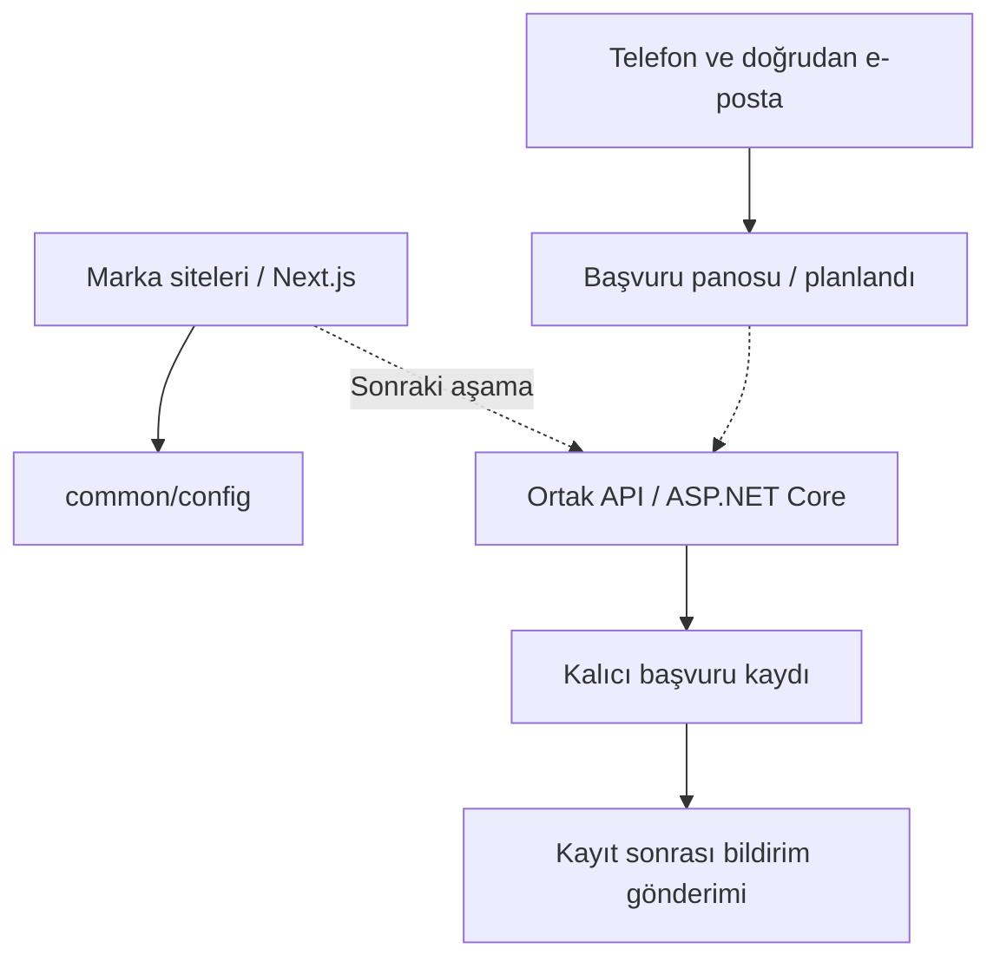

# Başlangıç mimarisi

## Kararlaştırılanlar

- Tek repo; her marka ayrı uygulama klasöründe ve bağımsız yayınlanabilir.
- Frontend: Next.js, React ve TypeScript.
- Varsayılan Hollandaca; İngilizce ve Türkçe sürümler.
- Ortak kod ve gelecekteki stilsiz form elemanları: `common/`.
- Backend: ASP.NET Core. İlk ihtiyaç ortak form kabulü ve kalıcı başvuru kaydı.
- Kendi componentlerimizle basit bir başvuru panosu; telefon ve doğrudan e-posta için elle kayıt.
- Başlangıçta Supabase kullanmıyoruz.

Diagramdaki API, pano, veritabanı ve e-posta akışı henüz uygulanmadı. İlk commit iki sitenin başlangıç iskeletini ve ortak config'i içerir.

## Açık kararlar

- Veritabanı motoru ve hosting; PostgreSQL aday.
- E-posta sağlayıcısı, marka adresleri ve ortak gelen kutusu.
- Pano giriş yöntemi ve başvuru durumları.
- Ortak bileşen API'si ve site başına style guide'lar.
- Seed of Life işareti ve aileyi bağlayan görsel sabitler.

Ortak bileşenler davranışı ve erişilebilirlik ilişkilerini taşıyabilir. Font, renk, gölge, boşluk ve hareket her markanın kendi stilinde belirlenir. Component uygulaması bu ilk kurulumun kapsamı dışında.
