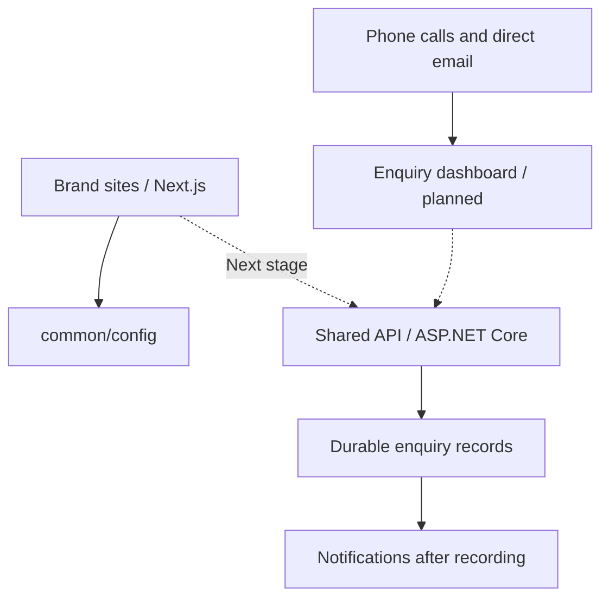

# Starter architecture

## Agreed direction

- One repository; each brand has a separate application directory and can be deployed independently.
- Frontend: Next.js, React, and TypeScript.
- Dutch by default, with English and Turkish versions.
- Shared code and future unstyled form elements: `common/`.
- Backend: ASP.NET Core. The first requirement is shared form intake and durable enquiry records.
- A simple enquiry dashboard built with our own components, including manual entry for phone calls and direct emails.
- No Supabase in the initial plan.

The API, dashboard, database, and email flow in this diagram are planned. The starter includes the two sites and shared config.

## Open decisions

- Database engine and hosting; PostgreSQL is a candidate.
- Email provider, brand addresses, and shared inbox.
- Dashboard authentication and enquiry statuses.
- Shared component API and each site's style guide.
- Seed of Life mark and the visual details connecting the brand family.

Shared components can provide behavior and accessibility relationships. Fonts, colors, shadows, spacing, and motion belong to each brand's own styles. Component implementation is outside this initial setup.
